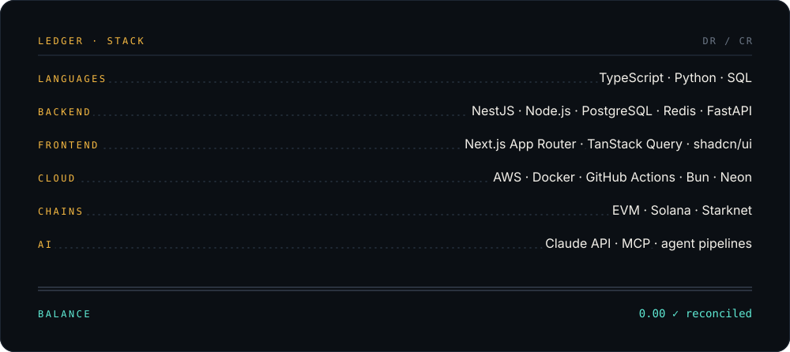

<div align="center">



<br/>

[](https://danih.dev)
[](https://www.linkedin.com/in/daniel-felipe-hurtado)


</div>

<br/>

Four years in production fintech, from intern to owning whole tracks end to end. I like the unglamorous parts of money software: idempotency, reconciliation, state machines, provider abstractions, and the compliance layer that decides whether a transfer is allowed to exist at all.

Now building independently: backend systems for clients, and AI agents that do real work.

<br/>

## What I build

<table>
<tr>
<td width="33%" valign="top">

**Money movement**

Cross-border corridors across MX, US, EU and CN. SPEI/CLABE rails, OTC matching engines, stablecoin on/off-ramps (Bitso, Rio, Walapay), multi-sig treasuries, and the reconciliation that keeps all of it honest.

</td>
<td width="33%" valign="top">

**Identity & compliance**

KYC/KYB pipelines, UBO verification, identity enrichment, and transfer gating. The checks that run before a cent moves.

</td>
<td width="33%" valign="top">

**Agents & automation**

A blog digest over 14 engineering blogs, an idea hunter across Reddit/HN/YC, an energy research agent, a content classifier. One Bun monorepo, GitHub Actions, Neon, Claude API.

</td>
</tr>
</table>

<br/>

## How I think about payments

```text
transfer:  INITIATED ─▶ SCREENED ─▶ FUNDED ─▶ SETTLED ─▶ RECONCILED

  idempotency   lives in the database, not in the handler
  providers     sit behind an interface; none leak into the domain
  state         changes through transitions, never through updates
  money         if it doesn't reconcile, it didn't happen
```

<br/>

## Stack



<br/>

## Selected work

- **[danih.dev](https://danih.dev)**: personal site on Next.js App Router, with SEO, GEO and `llms.txt` infrastructure built in.
- **`nextjs-app-router` skill**: a Claude Code skill that encodes how I build Next.js 16 apps with Next as the full backend: data access layer, Server Actions, auth, caching, i18n, SEO, performance.
- **Personal agent suite**: research and monitoring agents on a shared Bun monorepo, built as portfolio pieces and tutorial material.

<br/>

## Background

BS in Computer Science, Tecnológico de Monterrey (2021–2025). Pivoting from backend toward AI engineering, and studying Postgres, Node internals and system design along the way.

<br/>

<div align="center">
<sub>Based in Cali, Colombia · Working remote · Reachable at <a href="https://danih.dev">danih.dev</a></sub>
</div>
